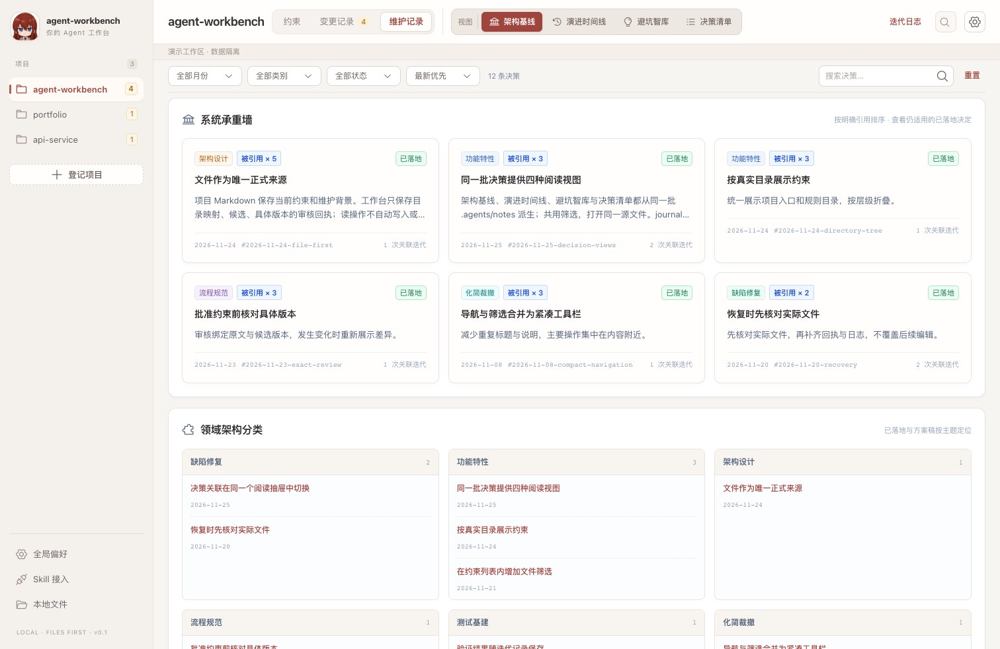
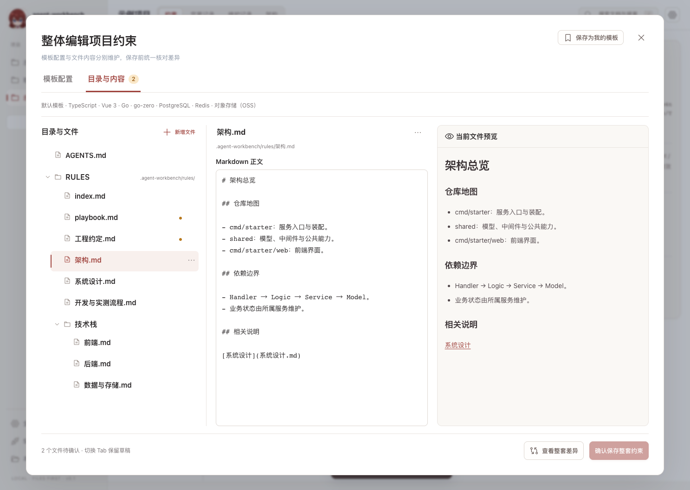
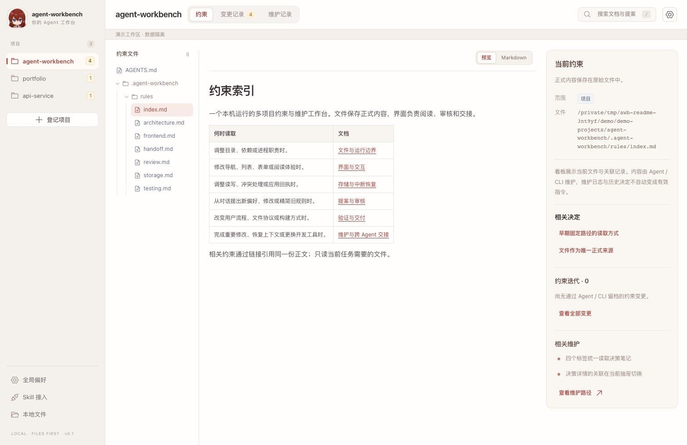
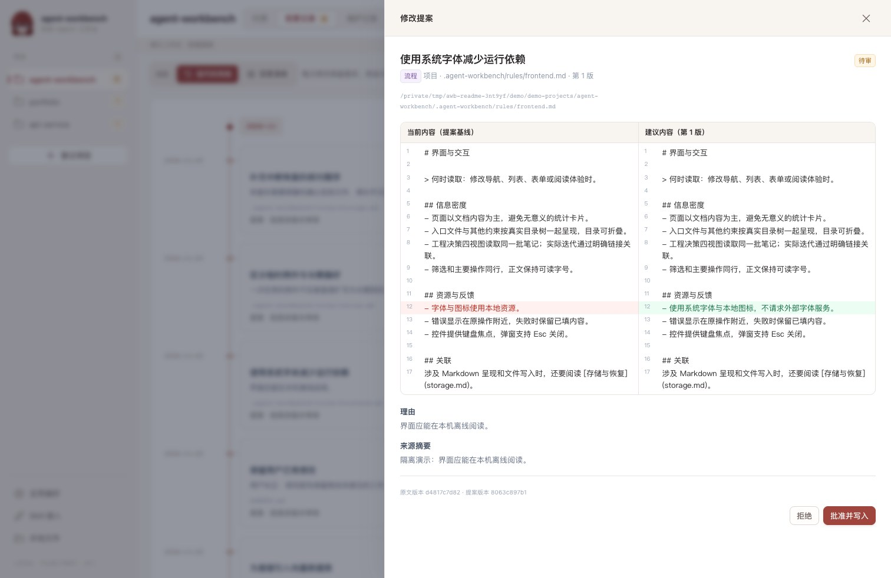
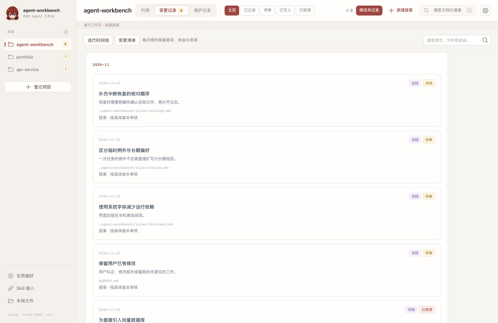
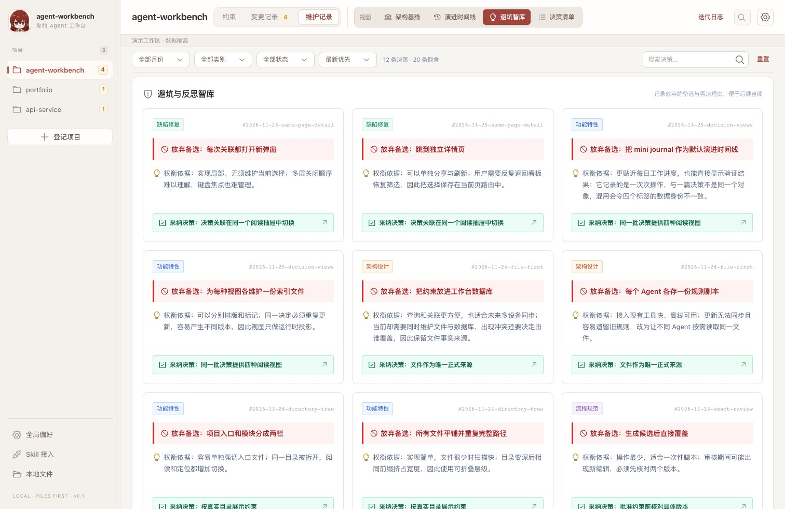
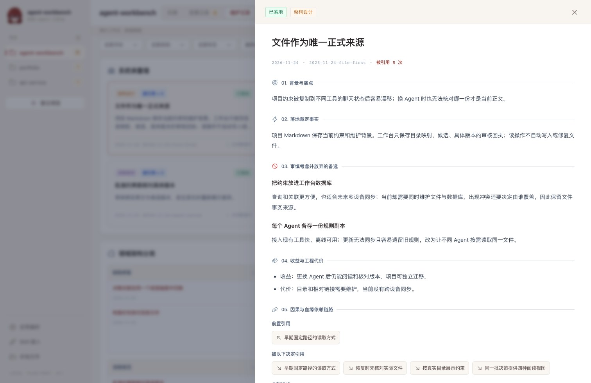
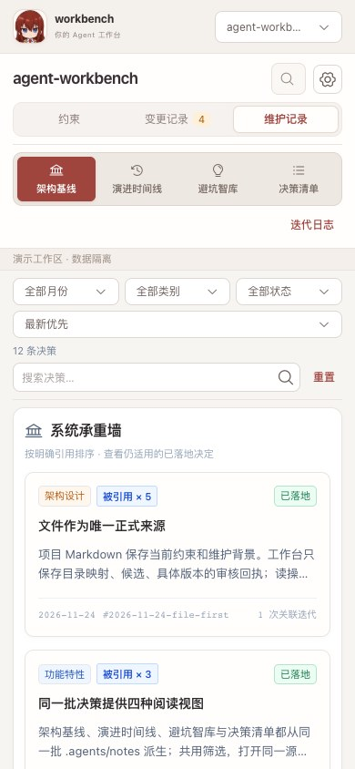
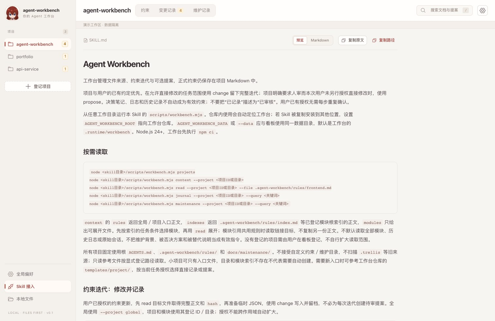

<div align="center">
  
  <h1>Agent Workbench</h1>
  <p><strong>把项目约束、修改来由和工程决策，留在下一位 Agent 找得到的地方。</strong></p>
  <p>本机运行 · Markdown 存储 · 多项目管理 · CLI / Skill 接入</p>
  <p>
    <a href="#快速开始">快速开始</a> ·
    <a href="#功能一览">功能一览</a> ·
    <a href="docs/images/README.md">界面图集</a> ·
    <a href="docs/usage.md">使用指南</a> ·
    <a href="#参考与致谢">参考与致谢</a>
  </p>
</div>



<p align="center"><sub>v0.1 实际运行界面 · 暖白与栗红主题 · 截图来自隔离演示项目，点击图片可查看大图</sub></p>

多个项目、多个 Agent、许多次会话之后，依然能找到三件事：**现在遵循什么、上次改了什么、当初为什么这样决定。**

工作台登记已有项目，按目录阅读约束，保存修改前后版本，并将实际迭代与工程决策关联起来。正式正文保存在项目 Markdown 中，便于交接和版本管理。

## 快速开始

需要 **Node.js 24+** 和 npm。在仓库根目录运行：

```sh
npm start
```

无需手动安装依赖：源码首次启动会按锁文件自动准备运行依赖（需要联网，不执行安装脚本），之后可离线启动。

打开 [本地工作台](http://127.0.0.1:4173)，登记一个已有项目目录即可开始。默认工作区为空，登记只保存映射，不创建或改写项目文件；非 Git 目录也可使用。

想先体验完整功能：

```sh
npm run demo -- --port 4174
```

打开 [演示工作台](http://127.0.0.1:4174)。内置工作台、作品站、API 服务三个虚构项目，包含约束、待审／已写入／拒绝／冲突提案、维护日志与决策笔记。演示数据与正式工作区隔离。

<details>
<summary>端口与数据目录</summary>

```sh
npm start -- --port 4180 --data /absolute/path/to/workbench-data
```

也可使用 `AGENT_WORKBENCH_DATA`。默认正式数据位于 `.runtime/workbench/`，演示位于 `.runtime/demo-v4/`；映射、候选、回执和锁均不提交 Git。服务只监听 `127.0.0.1`。

</details>

<details>
<summary>离线分发版：解压即用</summary>

`npm run build` 会生成内置运行依赖的 `dist/agent-workbench-0.1.0.tgz`。将它复制到装有 Node.js 24+ 的电脑，解压后进入 `package/` 目录：

```sh
node start.mjs
```

无需 npm 安装或联网。演示使用 `node start.mjs --demo --port 4174`；CLI 和 Skill 一同包含在包中。此文件由本地构建生成，目前没有发布远端下载版本。

</details>

## 功能一览

| 你想做什么 | 从哪里开始 | 可以得到什么 |
| --- | --- | --- |
| 整体维护项目约束 | **约束** → 整体编辑 | 同页调整目录与正文，当前文件预览、整套差异保存和模板复用 |
| 找到当前任务的约束 | **约束** → 文件树 | 项目入口、按需模块、预览／Markdown 切换与关联记录 |
| 追溯一次约束修改 | **变更记录** → 时间线／清单 | 修改前后版本、类别、理由、来源与同页详情 |
| 审核 Agent 提交的修改方案 | **变更记录** → 待审提案 | 精确差异审核、拒绝原因、原文冲突提示与重新提案 |
| 核对需求完成情况 | **验收** | 逐项标准、验证历史、证据、代码审核及交付信息 |
| 理解架构与历史取舍 | **维护记录** → 四种视图 | 架构基线、演进时间线、避坑智库、决策清单 |
| 阅读代码架构与数据流 | **架构** | 目录联动图示、节点／关系文档、独立代码片段、子图与版本对比 |
| 回看实际发生的迭代 | **维护记录** → 关联来源 | 背景、结果、验证、后续，以及决策／文件链接 |
| 给 Code Agent 交接 | **Skill 接入** / CLI | 按需读取约束、查询维护背景、记录修改、校验与归档决策 |

### 01 · 约束按目录展开，正文安静阅读

约束页按文件阅读，左侧目录展示真实文件结构。“整体编辑”分为 **模板配置** 和 **目录与内容** 两个 Tab，共用同一份草稿。配置技术栈后，在三栏编辑区选择文件、编辑正文并预览当前文件；改名、移动和移除从文件的更多菜单进入，新增或调整位置时才显示临时表单。查看整套差异后统一保存，留下一条维护记录。

“默认模板”自动包含工程约定、开发与实测流程、playbook，并按前后端语言／框架、数据库、缓存及文件存储生成对应技术规则。架构、系统设计作为只读写作参考，已有项目文档保留。同名文件和手工修改须明确处理，配置切换和查看差异不会丢失草稿。也可保存为个人模板；模板不复制维护历史。参考约束的保留、适配和缺失依赖见[来源对照](docs/research/template-adaptation.md)。



项目入口与模块遵循真实文件树，按需展开。正文支持 **预览 / Markdown** 切换；文件路径、相关变更和维护背景集中在右侧栏，全局偏好有独立入口。



### 02 · 每次修改，都有前后版本和来由

内容由 Agent / CLI 维护：获授权的直接修改通过 CLI `change` 留档，需要讨论时提交待审提案。看板支持整套项目约束编辑与差异确认；已有单文件变更和提案仍由 Agent / CLI 提交，日志随保存留档。审核绑定原文与候选的具体版本，原文变化时停止写入。写入前检查日志解析结构与关联决策；格式错误的决策在维护页提示，不进入架构基线。格式通过仍需核对内容与实际验证，详见[校验边界](docs/research/write-validation.md)。详情展示差异、理由与来源，修改或审核写入后同步追加维护日志。



<details>
<summary>查看变更记录时间线</summary>



时间线和清单共用同一批记录。每次新修改或提案必须选择类别，历史无标签的记录显示“未标注”。

</details>

### 03 · 看见决定，也看见放弃的路

**架构基线、演进时间线、避坑智库、决策清单**是同一批 `.agents/notes` 的四种视图。时间线按笔记日期分月展示，清单提供紧凑表格；共用月份、类别、状态、关键词与排序，切换视图保留筛选条件。历史维护日志通过决定详情中的关联来源阅读。

<table>
  <tr>
    <td width="50%"><a href="docs/images/decisions.jpg"></a></td>
    <td width="50%"><a href="docs/images/pitfalls.jpg"></a></td>
  </tr>
  <tr>
    <td><strong>架构基线</strong> · 找到当前决定和领域主题</td>
    <td><strong>避坑智库</strong> · 了解备选与否决理由</td>
  </tr>
</table>

<details>
<summary>查看决策详情与手机布局</summary>



<p align="center"></p>

看板只读展示工程决策；正文、状态与归档由 Agent / CLI 维护。方案稿、被否决、归档与已落地内容分别标注，历史决定不会自动成为有效约束。

</details>

### 04 · 在已有 Code Agent 中继续工作

使用仓库内 [Agent Workbench Skill](skills/agent-workbench/SKILL.md)，无需先全局安装：

```sh
node skills/agent-workbench/scripts/workbench.mjs projects
node skills/agent-workbench/scripts/workbench.mjs context --project /absolute/path/to/project
node skills/agent-workbench/scripts/workbench.mjs read --project PROJECT_ID --file .agent-workbench/rules/frontend.md
node skills/agent-workbench/scripts/workbench.mjs journal --project PROJECT_ID --query 关键词
```

`context` 提供全局／项目入口、模块根索引与模块文件列表；正文按任务需要再 `read`。CLI 还支持直接修改留档、维护记录、提案及决策校验／归档，没有提案批准命令。[维护记录流程](skills/agent-workbench/references/maintenance-records.md)与[记录输入模板](skills/agent-workbench/assets/maintenance/record.xml)属于 Skill；实际日志仍保存在项目中。复制安装 Skill 时，用 `AGENT_WORKBENCH_ROOT` 指向本仓库。

<details>
<summary>查看 Skill 接入页面</summary>



</details>

### 05 · 架构图与代码一起阅读

项目的 **架构** 页用三栏展示代码目录、交互图示和说明文档。节点只显示标题与简短描述，点击节点、连线或说明标签，右侧展开文档和关联代码；每段代码独立成块，按列表排列，可复制或定位当前源码。含子图的节点通过“进入子图”展开，返回时恢复父图选择和视野。

**生成新版本** 创建可复制的 Agent 任务，由现有 Agent / Skill 阅读源码生成 XML，再校验并导入候选。看板没有内置模型调用。用户可对比版本、采用候选、保留历史及导出 SVG／离线 HTML；采用自动追加维护记录。已引用源码变化会提示，历史片段仍显示版本快照。格式与引用检查不等于运行验证。

正式数据保存在项目 `.agent-workbench/architecture/`，不进入 RULES 或默认 Agent 上下文。首次打开空项目不创建文件；全局偏好没有架构页。详见 Skill 的[架构版本](skills/agent-workbench/references/architecture.md)。

## 文件就是交接入口

```text
你的项目/
├── AGENTS.md                     # 项目入口与当前约束
├── .agent-workbench/rules/
│   ├── index.md                  # 按任务选择模块
│   └── frontend.md               # 按需拆分的约束
├── .agents/notes/                # 工程决策与取舍
│   ├── proposed/
│   ├── implemented/
│   ├── rejected/
│   └── archived/
└── docs/maintenance/YYYY-MM.md   # 实际迭代、验证与后续
```

约束与维护目录固定，目录不存在时不自动创建。既有契约、README 或背景资料可通过 `referenceFiles` 逐文件登记为只读参考；它们不加入有效约束或自动上下文。详见 [目录约定](docs/directory-convention.md)。

## 开发与验证

v0.1 使用 **mini-trellis-core 0.4.2 + 本机 Node 进程 + 原生浏览器页面**，无需数据库或专属模型服务。

```sh
npm ci --ignore-scripts
npm run check
npm test
npm run build
npm run test:package
npm run test:ui
```

开发时先安装完整依赖（包含 Playwright）；日常启动自动准备的仅为运行依赖。浏览器验收使用临时目录与独立浏览器配置。`build` 输出内置依赖、源码、静态页面、Skill 和许可的 `dist/` 及可解压分发包，没有前端编译链。`test:package` 在独立临时目录解压分发包，禁用 npm 入口后验证离线启动和资源读取。

| 文档 | 内容 |
| --- | --- |
| [使用与维护指南](docs/usage.md) | 启动参数、写入语义、CLI、校验、归档和分发 |
| [界面图集](docs/images/README.md) | 8 张实际截图、功能入口与重新截图方法 |
| [HTTP 接口](docs/api.md) | 请求字段、版本核对与重试约定 |
| [整体设计](docs/design.md) / [源码审查](docs/research/source-review.md) | 当前边界、设计来由与上游复用依据 |
| [视觉验收](design-qa.md) / [维护记录](docs/maintenance/2026-11.md) | 验收证据与重要修改记录 |
| [历史交互设计稿](docs/ui/interaction-previews/README.md) | 17 张早期静态设计稿与功能对照 |

<details>
<summary>当前边界</summary>

- 看板未提供工程笔记编辑／归档按钮；Skill / CLI 已提供决策流程与归档写入。
- 外部工具直接编辑约束时，没有最后已审快照或自动送审；`context` 读取磁盘现状。已有候选在批准前再次核对版本。
- 未实现聊天历史导入、跨设备同步、常驻观察 Agent 或后台自动提炼；当前不接 CloudCLI。提炼由加载 Skill 的宿主 Agent 按需执行，尚未评估真实对话准确率。
- 文件查看受单文件 1 MB 与扫描上限约束，不完整时提示。Markdown 原始 HTML 以文本呈现，图片显示为链接，不自动加载外部资源。
- 本机写入流程不构成对同一用户其他文件工具的系统级隔离。普通维护不强制产出新规则；约束变化遵守用户授权和项目约定。

</details>

## 参考与致谢

特别感谢 **[czm15053 / write-notes-like-deepseek](https://github.com/czm15053/write-notes-like-deepseek)**。本项目参考了它将工程决定、备选方案、收益代价与验证留在仓库中的方法，以及决策笔记生命周期和看板四视图的组织方式。这些思路帮助工作台把“现在的约束”与“当初的取舍”联系起来。

同样感谢 **[Tiger-zzZ / mini-trellis](https://github.com/Tiger-zzZ/mini-trellis)**。本项目参考了它记录实际修改、验证与后续的维护日志方法，以及按需读取文档和追溯来源关系的思路；代码中实际使用 `mini-trellis-core 0.4.2` 的文档替代关系解析与查询辅助能力。具体复用范围见 [mini-trellis 源码审查与取用边界](docs/research/mini-trellis.md)。

也感谢 [Compound Engineering](https://github.com/EveryInc/compound-engineering-plugin)、[ECC](https://github.com/affaan-m/ECC) 的文档实践启发。

决策工具与页面由本项目独立实现；具体取用版本和边界见 [决策流程来源](docs/research/note-sources.md) 与 [NOTICE](NOTICE)。

本项目使用 **AGPL-3.0**，保留依赖的许可与归属。见 [LICENSE](LICENSE)。

## 需求验收

项目顶部的「验收」按需求展示标准、验证结果、代码审核和交付情况，并与维护记录中的决定双向关联。需求和多轮结果共存于 `docs/需求/进行中/` 或 `docs/需求/已完成/` 的 Markdown。Agent 使用 `acceptance` CLI 与 XML 输入维护，原文其他区段保留。旧需求可以阅读，尚无结构结果时显示未记录。详细用法见 [验收流程](skills/agent-workbench/references/acceptance.md)。
