# 界面图集

[← 项目首页](../../README.md) · [使用指南](../usage.md) · [历史设计稿](../ui/interaction-previews/README.md)

**2026-11-25 · v0.1 · 8 张实际运行截图。** 使用当前应用、隔离演示项目与全新浏览器配置拍摄。截图中的项目、约束和历史为虚构样本。

## 阅读与审核

<table>
  <tr>
    <td width="50%"><a href="rules.jpg">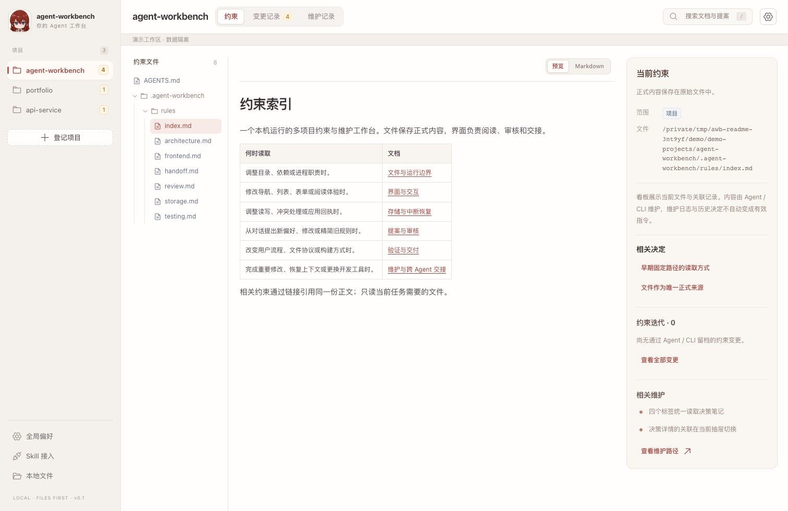</a></td>
    <td width="50%"><a href="changes.jpg">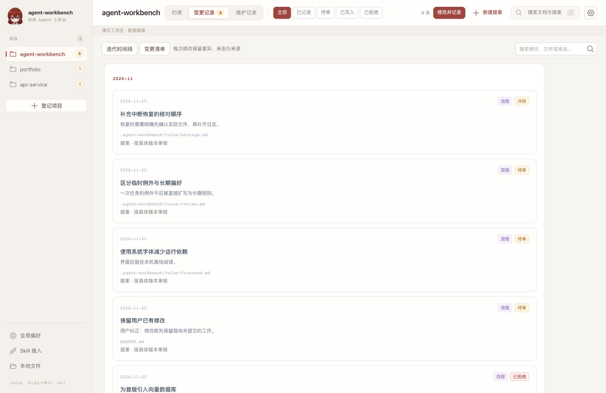</a></td>
  </tr>
  <tr>
    <td><strong>约束阅读</strong><br>约束 → 文件树：按任务找到模块，切换预览 / Markdown，查看右侧关联。</td>
    <td><strong>变更时间线</strong><br>变更记录 → 迭代时间线：按月查找修改，使用状态筛选或搜索。</td>
  </tr>
  <tr>
    <td><a href="review.jpg">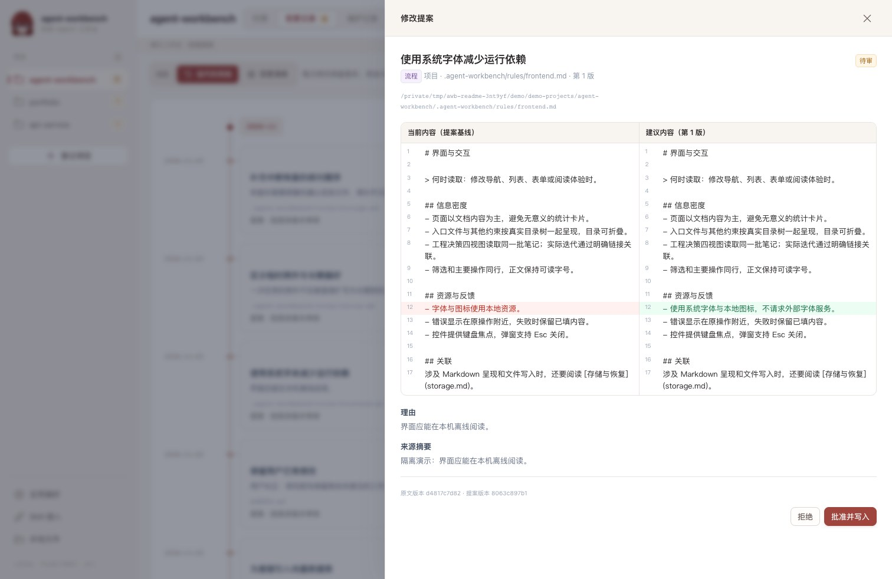</a></td>
    <td><a href="decision-detail.jpg">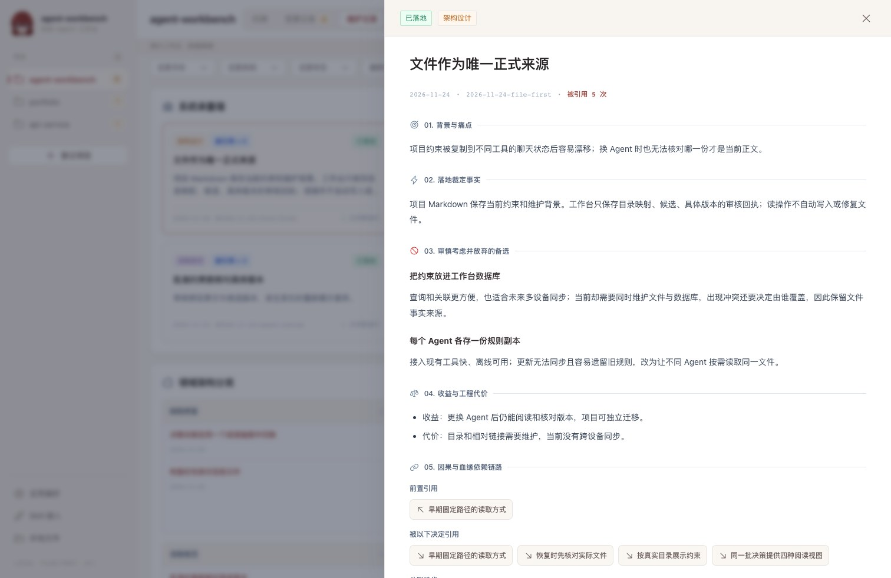</a></td>
  </tr>
  <tr>
    <td><strong>差异审核</strong><br>变更记录 → 待审提案：对照原文与建议内容，查看理由、来源与具体版本。</td>
    <td><strong>决策详情</strong><br>维护记录 → 决策卡片：阅读问题、采用方案、备选、代价与关联迭代。</td>
  </tr>
</table>

## 决策与交接

<table>
  <tr>
    <td width="50%"><a href="decisions.jpg">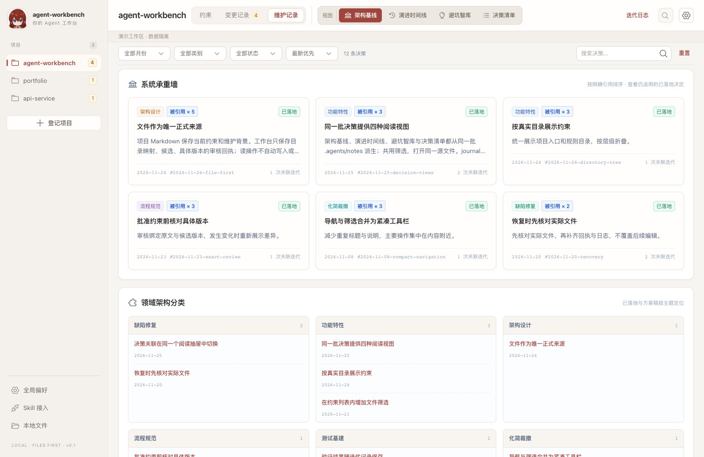</a></td>
    <td width="50%"><a href="pitfalls.jpg">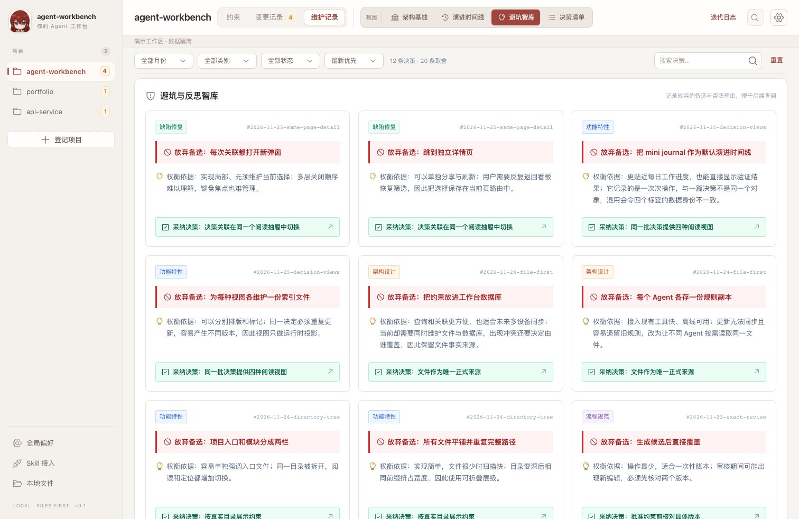</a></td>
  </tr>
  <tr>
    <td><strong>架构基线</strong><br>维护记录 → 架构基线：查看当前决定、引用权重与领域分类。</td>
    <td><strong>避坑智库</strong><br>维护记录 → 避坑智库：查找放弃的备选及当时的权衡依据。</td>
  </tr>
</table>

### Skill 接入

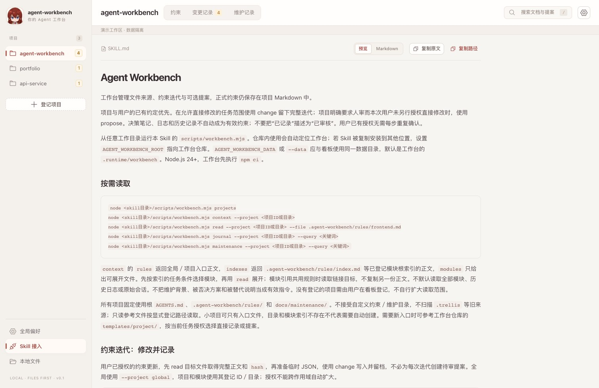

左下角 **Skill 接入**：阅读与复制 Skill，打开决策写作参考及模板。命令说明见 [使用指南](../usage.md#code-agent-skill)。

### 手机布局

<p align="center"><a href="mobile.jpg">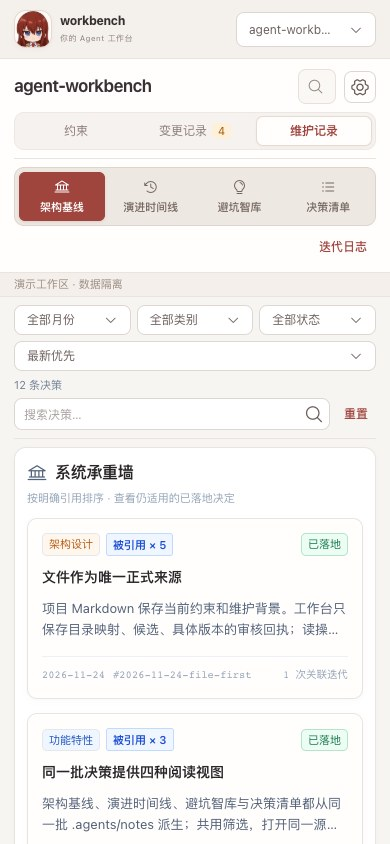</a></p>

顶部切换项目；约束、变更记录和维护记录保留各自入口，筛选和卡片随窄屏排列。

## 更新截图

在源码仓库安装开发依赖后运行：

```sh
node scripts/capture-readme.mjs
```

脚本在临时目录初始化演示数据，启动随机本机端口，并使用独立无头浏览器逐页截图；结束后关闭浏览器、服务并清理临时工作区。不读取真实项目或浏览器会话。

- 桌面：1512 × 982；手机：390 × 844。
- 输出：本目录下 8 张 JPEG，质量 88；全部是浏览器原始截图。
- 浏览器：优先使用本机 Chrome，可通过 `AWB_CHROME` 指定；也可安装 Playwright Chromium。
- 截图时检查页面无横向溢出、无浏览器运行错误；功能验收另见 `npm run test:ui`。

工程决策笔记与四视图的组织方式参考 [write-notes-like-deepseek](https://github.com/czm15053/write-notes-like-deepseek)，感谢原作者的公开分享。历史静态设计稿单独保留在 [交互预览目录](../ui/interaction-previews/README.md)。

## 整套项目约束

本轮实际页面截图：整体编辑分为模板配置、目录与内容，切换保留草稿；文件位置操作在临时表单中完成。通过 `node scripts/verify-template-ui.mjs` 使用隔离项目生成下面两张 1487×1058 的截图，来源与功能证据位于 `.local/tabbed-template-ui/`；文件菜单、差异与手机截图另见 `.local/constraint-set-previews/`。

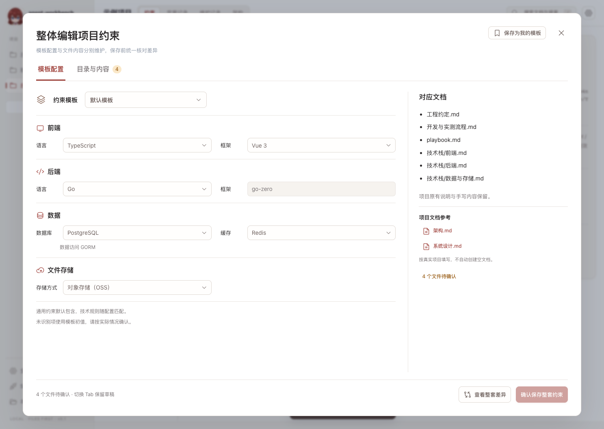

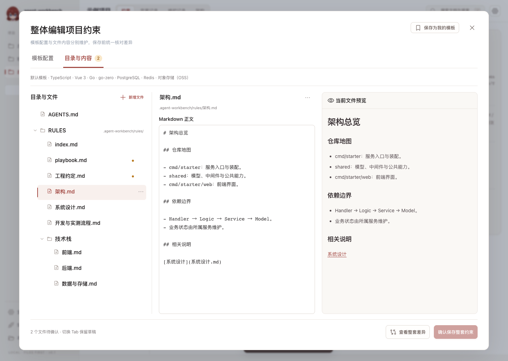

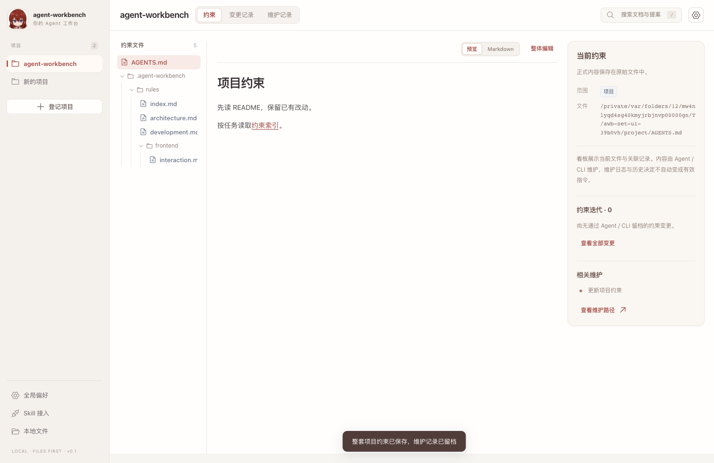
