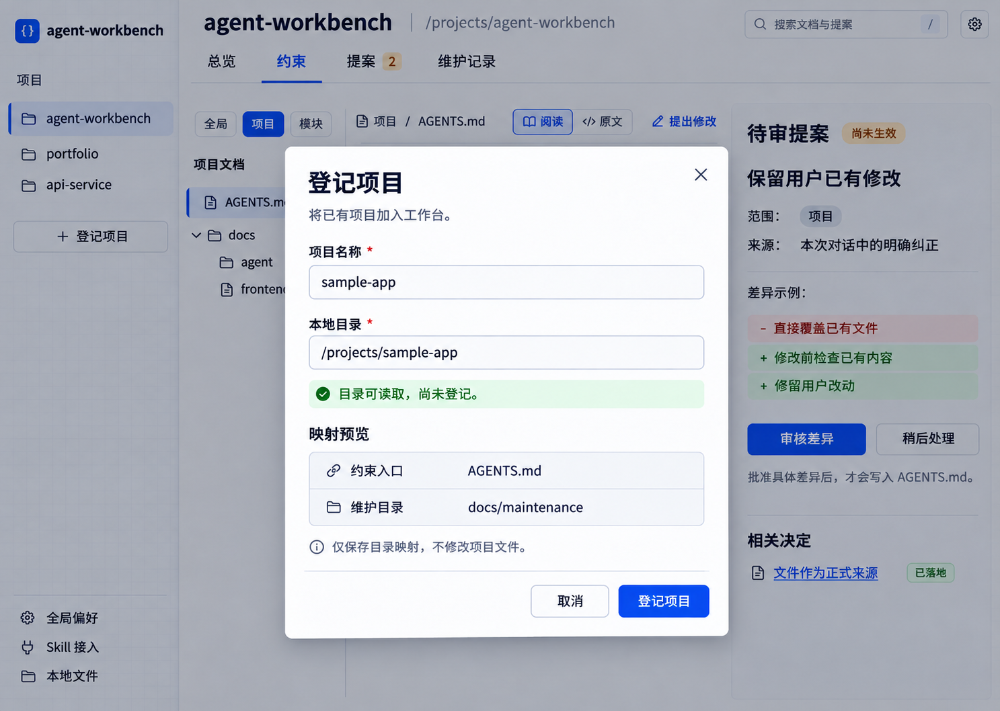
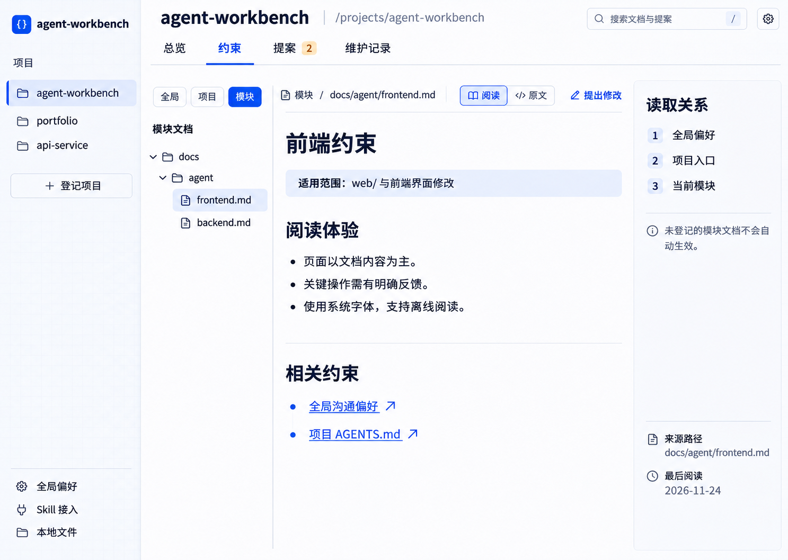
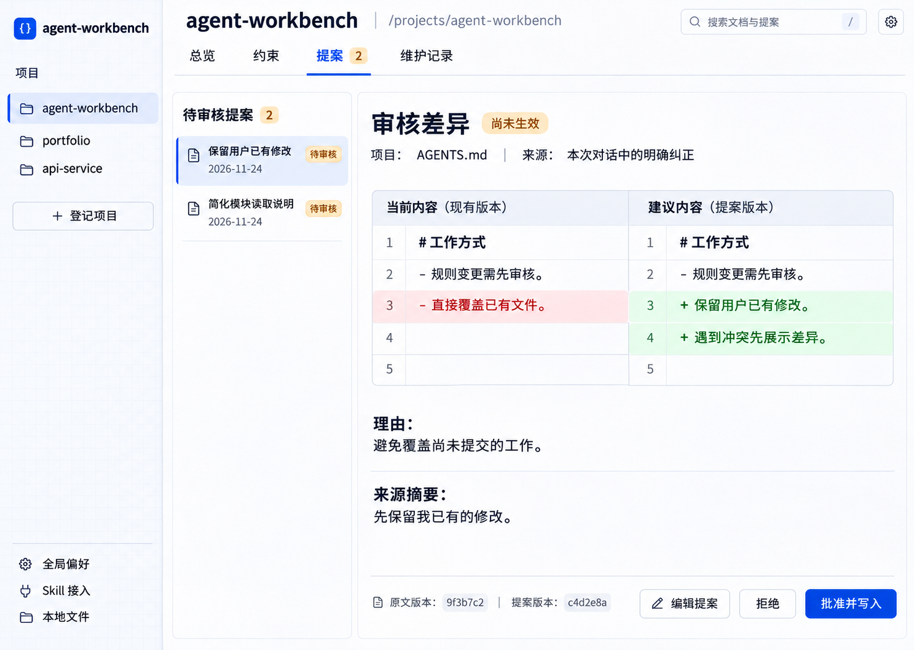
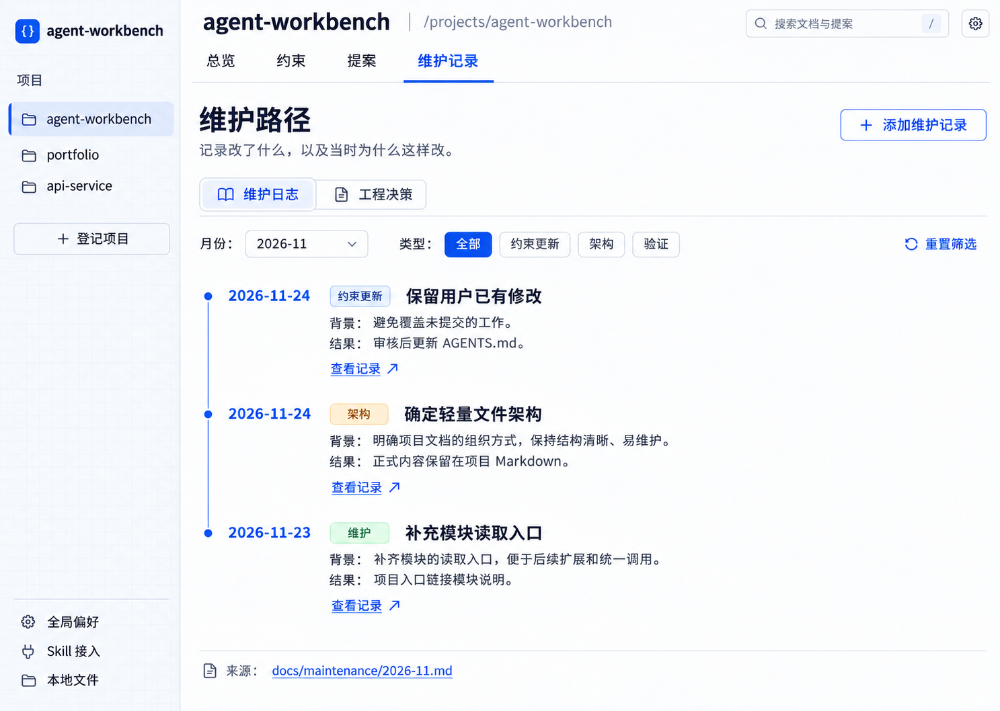
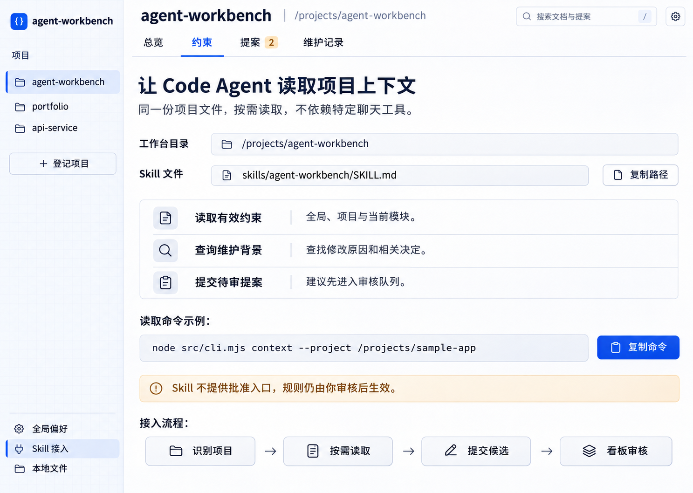
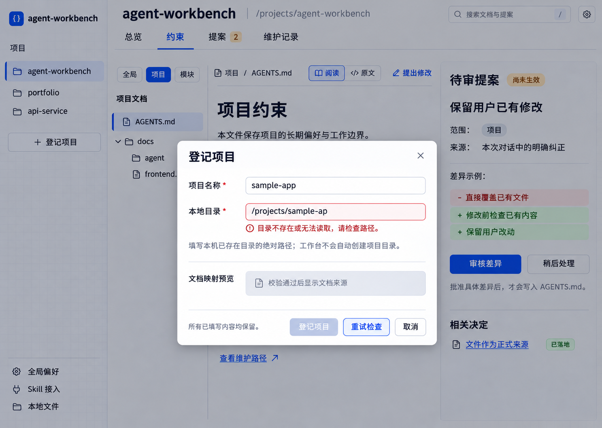

# 交互设计档案

[← 项目首页](../../../README.md) · [当前界面截图](../../images/README.md) · [完整设计稿画廊](index.html)

**2026-11-24 · 17 张早期设计稿 · 内置 image_gen 逐张生成。**

> 本目录保存静态设计稿。它们使用早期蓝白风格，部分入口和文案已经调整；当前暖色界面与已实现行为，请看 [实际运行截图](../../images/README.md) 和 [使用指南](../../usage.md)。

## 按任务浏览

<table>
  <tr>
    <td width="33%"></td>
    <td width="33%"></td>
    <td width="33%"></td>
  </tr>
  <tr>
    <td><strong>登记项目</strong> · 01–02</td>
    <td><strong>阅读与查找</strong> · 03–04</td>
    <td><strong>提出与审核</strong> · 05–11</td>
  </tr>
  <tr>
    <td></td>
    <td></td>
    <td></td>
  </tr>
  <tr>
    <td><strong>维护与决策</strong> · 12–14</td>
    <td><strong>Agent 接入</strong> · 15</td>
    <td><strong>空状态与错误</strong> · 16–17</td>
  </tr>
</table>

## 设计与当前实现的对照

| 早期设计 | 当前实现 |
| --- | --- |
| 自定义入口、模块与维护目录 | 固定为 AGENTS.md、.agent-workbench/rules/、docs/maintenance/；只读参考可逐文件登记 |
| 阅读／原文切换 | 统一为预览／Markdown 分段控件 |
| 以待审提案为主要入口 | 变更记录同时呈现直接修改留档和可选提案 |
| 维护时间线 | 工程决策采用四视图；实际迭代从独立日志入口或关联进入 |
| 蓝白配色 | 暖白、栗红主题与红莉栖头像 |

## 全部 17 张设计稿

以下“目标”描述当时的设计意图，具体功能以当前实现与验收为准。点击名称可打开原图。

| 编号 | 交互图 | 目标 |
| --- | --- | --- |
| 01 | [登记项目](01-register-project.png) | 填写项目名称与本机目录，预览已发现的文档映射，仅登记，不改项目文件。 |
| 02 | [配置文档来源](02-configure-sources.png) | 配置全局偏好文件、项目入口、模块目录与维护目录，保存来源映射。 |
| 03 | [切换并阅读模块约束](03-read-module-rules.png) | 按全局、项目、模块切换，阅读约束与适用范围，支持原文切换和关联文档。 |
| 04 | [搜索文档与提案](04-search.png) | 在当前项目中查找文档、待审提案和维护记录，结果保留来源。 |
| 05 | [新建提案](05-create-proposal.png) | 填写目标文件、完整建议内容、修改理由与来源，保存为待审提案。 |
| 06 | [编辑待审提案](06-edit-proposal.png) | 修改候选文本和理由，保存后重新查看最终差异，不沿用旧版批准。 |
| 07 | [审核差异](07-review-diff.png) | 并排核对当前内容、建议内容、来源与理由，准确区分新增和删除。 |
| 08 | [批准当前差异](08-approve.png) | 核对本次写入的目标与影响范围，绑定已查看的具体差异后批准。 |
| 09 | [写入成功](09-applied.png) | 查看更新后的约束以及关联维护记录；文件写入成功不代表功能测试通过。 |
| 10 | [拒绝提案](10-reject.png) | 填写拒绝原因，保留判断依据，不改原约束文件。 |
| 11 | [原文冲突](11-conflict.png) | 检测到原文变化时停止写入，基于当前原文生成新待审提案并重新审核。 |
| 12 | [维护路径](12-maintenance-timeline.png) | 按月份与类型筛选维护记录，追溯背景、结果和验证。 |
| 13 | [添加维护记录](13-create-journal-entry.png) | 填写发生过的事实：背景、实际结果、验证、后续及关联文件；不自动形成规则。 |
| 14 | [决策详情](14-decision-detail.png) | 侧栏展示背景、采用方案、真实备选、收益代价和关联文档；工程决定状态与约束审核状态分开。 |
| 15 | [Skill 接入](15-skill-connection.png) | 展示 Skill 位置与命令示例；支持读取约束、查询背景和提交候选，不提供批准入口。 |
| 16 | [待审队列为空](16-empty-proposals.png) | 无待审提案时提供新建提案、查看已处理记录与 Skill 接入入口。 |
| 17 | [目录不可读](17-directory-error.png) | 目录校验失败时保留输入、就地显示原因，修正路径后重试，不自动创建目录。 |

## 来源与生成记录

布局与工程决策表达参考 [write-notes-like-deepseek](https://github.com/czm15053/write-notes-like-deepseek)，感谢原作者的设计与方法分享。这里的图片由本项目独立生成。

生成风格提示和逐张目标摘要见 [manifest.json](manifest.json)。完整图集可在 [HTML 画廊](index.html) 连续浏览；实现验收见 [视觉验收记录](../../../design-qa.md)。
