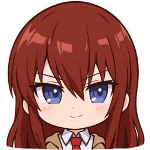
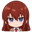
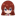

# 红莉栖 · 品牌素材

[← 项目首页](../../README.md) · [实际界面](../../docs/images/README.md)

<p align="center">
  
  <br><strong>暖栗色头发 · 蓝色眼睛 · 透明背景</strong>
  <br><sub>侧栏、浏览器页签与主屏幕图标共用同一份形象</sub>
</p>

2026-11-25 按用户要求，通过内置 `image_gen` 生成 Q 版牧濑红莉栖头像。全部引用使用仓库内静态资源，无运行时图片服务。

## 预览与用途

| 预览 | 文件 | 尺寸 | 使用位置 |
| --- | --- | --- | --- |
|  | [kurisu-avatar.png](kurisu-avatar.png) | 256 × 256 | 工作台侧栏品牌 |
|  | [kurisu-favicon-32.png](kurisu-favicon-32.png) | 32 × 32 | 浏览器页签 |
|  | [kurisu-favicon-16.png](kurisu-favicon-16.png) | 16 × 16 | ICO 小尺寸来源 |
|  | [kurisu-icon-192.png](kurisu-icon-192.png) | 192 × 192 | 高分辨率图标 |
|  | [kurisu-apple-touch-icon.png](kurisu-apple-touch-icon.png) | 180 × 180 | Apple 主屏幕图标 |
| — | [favicon.ico](favicon.ico) | 16 / 32 两档 | 默认图标请求与显式 ICO 声明 |

## 生成与更新

派生 PNG 由 macOS `sips` 等比例缩小原始方图，保留透明度；ICO 封装派生的 16 / 32 PNG。未使用 CLI / API fallback，未更换图像生成服务。

首页图标声明在 [web/index.html](../index.html)，侧栏引用在 [web/app.js](../app.js)。页签的 ICO 与 32px PNG 使用固定素材版本参数；更换图标时需同步更新版本，避免已打开页面继续使用旧缓存。

<details>
<summary>查看完整生成提示词</summary>

## 最终生成提示词

```text
Use case: logo-brand. Asset type: square app mascot avatar used at 40 pixels in a developer workbench sidebar and at 16–32 pixels as browser favicon. Primary request: a beautifully drawn chibi Makise Kurisu (红莉栖) from Steins;Gate, recognizable long auburn reddish-brown hair with her side swept bangs, expressive blue eyes, white shirt collar and red necktie with a little beige jacket at shoulders. Only head and tiny upper shoulders, oversized face, friendly confident subtle smile, slightly tsundere personality. Style: polished clean anime chibi icon, bold smooth dark brown outlines, large simple shapes, flat colors with restrained cel shading. Composition: perfectly centered face filling most of square canvas, symmetrical enough to read at favicon size, all hair safely inside a small 5% margin. Transparent background, crisp alpha edges. No text, letters, watermark, props, frame, gradients or busy background. Warm auburn hair should dominate the silhouette; premium cute character avatar.
```

</details>
